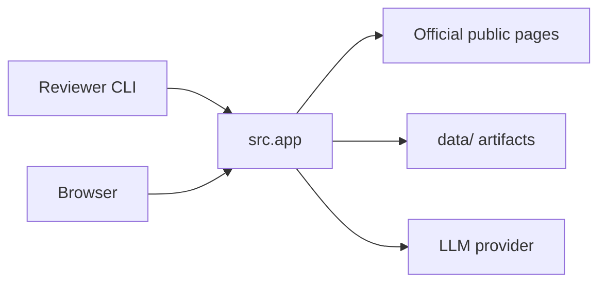
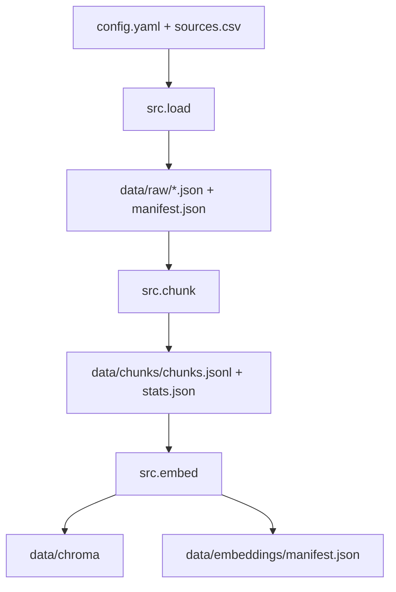
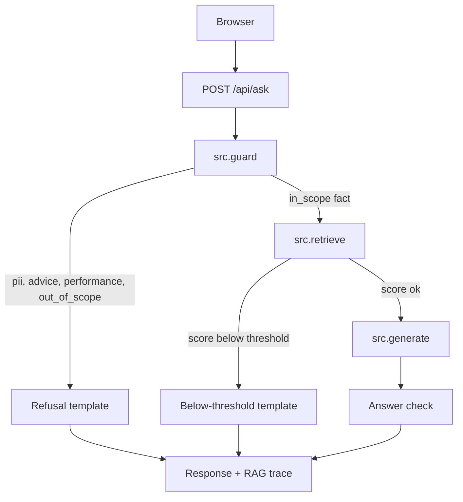
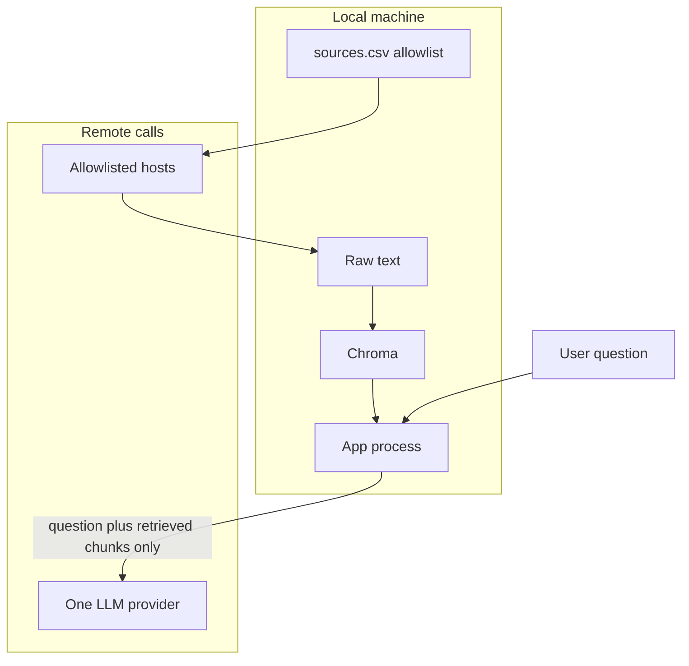

# Architecture: HDFC Mutual Fund Facts FAQ

**Status:** Draft for build  
**Source:** `PRD.md`  
**Runtime:** One Python app. Offline commands build the corpus. One local web page answers questions.

The system is a small RAG pipeline with a hard gate in front of the model. Ingestion writes every stage to disk. A question is classified before any LLM call. Only an in-scope factual question, with retrieved chunks above the score threshold, is sent to the model. Refusals are templates. The model never sees the open web, and it never chooses a URL that was not retrieved or configured.

## 1. System context



| Actor | Talks to | Does not talk to |
| --- | --- | --- |
| Reviewer | Phase CLIs: load, chunk, embed | LLM providers during ingestion |
| Retail or support user | `GET /` and `POST /api/ask` | Groww, Chroma, or the embedding model directly |
| Loader | Allowlisted HTTPS URLs only | Blogs, the Groww app backend, user accounts |
| Embedder | Local `sentence-transformers` and Chroma | Groq, Gemini, OpenAI, Anthropic, Mistral |
| Generator | One configured LLM provider | Any URL outside the retrieved set and `educational_url` |

There is no login, no session store, and no chat history. Each request is independent.

## 2. Two runtimes

### 2.1 Offline ingestion

Run once, and again whenever sources change. Stages are separate processes so a reviewer can open the files between them.



Commands:

1. `python -m src.load` — fetch allowlisted URLs, write raw JSON.
2. `python -m src.chunk` — read raw JSON, write `chunks.jsonl` and `stats.json`.
3. `python -m src.embed` — embed `chunks.jsonl` into Chroma and write the embedding manifest.

Each command prints its output path and record count, then exits. Load does not chunk. Chunk does not embed. Embed does not call an LLM.

### 2.2 Online ask path

`python -m src.app` loads config, checks the active API key and `LLM_MODEL`, opens Chroma, and loads MiniLM once. It serves a single page.



PII is dropped before retrieval, so the question text is never embedded and never written to logs or `data/`.

## 3. Modules

Layout from the PRD, plus three internal modules (`config`, `llm`, `prompts`) that the phase entry points call.

```
config.yaml
.env.example
src/config.py       shared settings and startup checks
src/load.py         phase 1
src/chunk.py        phase 2, strategy section_prefix_v1
src/embed.py        phase 3 and 4
src/retrieve.py     phase 5, query embedding + Chroma
src/guard.py        route before the LLM
src/generate.py     phase 6, answer contract
src/llm.py          provider adapter
src/prompts.py      system prompt text
src/app.py          FastAPI page and /api/ask
src/static/index.html
```

| Module | Responsibility | Reads | Writes |
| --- | --- | --- | --- |
| `config.py` | Load `config.yaml` and `.env`. Fail if `LLM_MODEL` or the active provider key is missing. | `config.yaml`, `.env` | Nothing |
| `load.py` | Fetch the allowlist. Extract visible text. Keep tables. | `sources.csv`, web, PDFs | `data/raw/` |
| `chunk.py` | Section-aware chunks with a metadata prefix and a token cap. | `data/raw/` | `data/chunks/` |
| `embed.py` | Embed locally and upsert Chroma. Skip or rebuild from the manifest. | `chunks.jsonl`, config | `data/chroma/`, `data/embeddings/manifest.json` |
| `retrieve.py` | Embed the question with the same model. Return top-k with scores. | Chroma, MiniLM | Nothing |
| `guard.py` | Classify the question. Build template refusals. | Config, scheme URL map | Nothing |
| `generate.py` | Call the LLM for factual answers. Enforce the answer contract. | Retrieved chunks, prompt | Nothing |
| `llm.py` | One `complete(system, user) -> str` method per provider. | Env key, `LLM_MODEL` | Nothing |
| `app.py` | HTTP, static page, redaction, error responses. | All of the above | Nothing on the PII path |

`app.py` is the only module that imports the others into one request. Phase CLIs import `config` and their own stage only.

## 4. Request lifecycle

1. `app.py` receives `{"question": "..."}`.
2. `guard.py` runs in this order: PII, advice, performance, out of scope, else in-scope fact.
3. A refusal returns immediately with one configured link:
   - PII, advice, and out of scope use `educational_url`.
   - Performance uses the named scheme’s factsheet URL from `sources.csv` (`why_included` contains `factsheet`). If none is listed, it uses that scheme’s page. If no scheme is named, it uses the AMC overview URL.
4. An in-scope fact calls `retrieve.py`.
5. If the best cosine similarity is below `score_threshold`, return the not-in-corpus template. Cite the named scheme page, or the AMC overview when no scheme is named. Do not call the LLM.
6. Otherwise `generate.py` sends the system prompt, the question, and the four chunks to `llm.py`.
7. The answer check accepts the text only when all of these hold:
   - At most `max_answer_sentences` sentences.
   - Exactly one URL.
   - That URL is one of the retrieved `source_url` values.
   - The last line matches `Last updated from sources: YYYY-MM-DD` and the date equals that chunk’s `fetched_at`.
   - Every numeric token in the answer also appears in the cited chunk.
8. If the check fails, `generate.py` retries once with the check errors appended. A second failure becomes the UI error state. The app does not show a draft that failed the check.
9. `app.py` returns the answer plus the RAG trace. For `refused_pii` the trace is `null` and the question is not copied into the response body.

## 5. Routing

Deterministic rules, not the LLM. First match wins.

| Order | Route | Detector | LLM called |
| --- | --- | --- | --- |
| 1 | `refused_pii` | Email, phone, PAN (`AAAAA9999A`), 12-digit Aadhaar, long account-like digit runs, OTP phrasing next to 4–8 digits | No |
| 2 | `refused_advice` | buy, sell, hold, switch, invest, “should I”, “is this good”, “which is best”, allocate, portfolio | No |
| 3 | `refused_performance` | return, CAGR, performance, alpha, ranking, “beating”, “higher returns”, compare funds on results | No |
| 4 | `refused_out_of_scope` | A named fund or AMC outside HDFC and the four schemes, and the question is not the statement how-to | No |
| 5 | `answer` | Expense ratio, exit load, minimum SIP, lock-in, riskometer, benchmark, or statement download | Only after retrieval passes the threshold |

Scheme detection is a small alias table in `guard.py`, built from `sources.csv` titles: Large Cap, Flexi Cap, ELSS / Tax Saver, Mid Cap, and HDFC Mutual Fund for the AMC overview. “HDFC Flexi Cap” and “HDFC Equity Fund” map to the same scheme, because that is the seed URL.

Statement-download questions stay on the `answer` route even without a scheme name. They still need a retrieved help-page chunk above the threshold.

No module computes returns. Chunk records have no derived performance fields. The performance route never formats a number from the corpus.

## 6. Ingestion design

### 6.1 Allowlist

`load.py` fetches only rows in `sources.csv`. It does not follow links at runtime. Adding a factsheet or help page means adding a row, then re-running load. The CSV is capped at 25 data rows in `load.py`; a longer file is an error.

Columns: `id`, `title`, `url`, `publisher`, `scheme_or_topic`, `fetched_at`, `why_included`.

`fetched_at` in the CSV is a placeholder until load succeeds. Load writes the UTC date it actually fetched into both the raw JSON and back into the CSV.

Publisher hosts allowed by config:

- `groww.in`
- the HDFC AMC site linked from those pages
- `sebi.gov.in` and `investor.sebi.gov.in`
- `amfiindia.com`
- `camsonline.com`
- `kfintech.com`

Any other host is skipped and printed as a gap. PDF links are allowed only on those hosts.

### 6.2 Raw document

One file, `data/raw/<id>.json`:

```json
{
  "id": "hdfc-elss",
  "url": "https://groww.in/mutual-funds/hdfc-elss-tax-saver-fund-direct-plan-growth",
  "title": "HDFC ELSS Tax Saver Fund Direct Plan Growth",
  "publisher": "groww.in",
  "scheme_or_topic": "HDFC ELSS Tax Saver Fund Direct Plan Growth",
  "fetched_at": "2026-11-01",
  "source_type": "html",
  "text": "visible article text with tables flattened to lines",
  "sections": [
    {"heading": "Exit load", "text": "..."}
  ],
  "content_hash": "sha256 of normalized text"
}
```

HTML: fetch with a normal browser user-agent, parse with BeautifulSoup, drop `script`, `style`, `nav`, and cookie banners, keep tables as lines of `label: value`. Headings become `sections`.

PDF (`source_type: pdf`): extract text with `pypdf`. If the PDF has no outline, treat each page as a section titled `Page N`.

Re-running load overwrites `data/raw/<id>.json`. Ids come from the CSV, so files do not duplicate. A failed URL is recorded in `data/raw/manifest.json` with `status: error` and an empty text file is not written. Other URLs still load.

`manifest.json`:

```json
{
  "generated_at": "2026-11-01T06:00:00Z",
  "documents": [
    {"id": "hdfc-elss", "path": "hdfc-elss.json", "url": "...", "status": "ok", "content_hash": "..."}
  ]
}
```

### 6.3 Chunking — `section_prefix_v1`

Implemented only in `chunk.py`. Token counts use the MiniLM tokenizer from `embedding_model`, so the cap matches what the embedder will encode.

For each raw document:

1. Read `sections`. A table line that contains a single fact (expense ratio, exit load, minimum SIP, lock-in, riskometer, benchmark) becomes its own section if the heading is generic.
2. Build the prefix: `AMC: HDFC Mutual Fund | Scheme: <scheme_or_topic> | Section: <heading> | Source: <url>`.
3. If `token_count(prefix + body) <= chunk_max_tokens` (default 180), emit one chunk.
4. Otherwise split the body on blank lines, then on sentences. Pack pieces until the next piece would pass the cap. Overlap the next chunk by `chunk_overlap_tokens` (default 40) of body text. The prefix is repeated on every piece.
5. Drop a chunk whose body is empty or whose body matches a denylist of site-wide lines (cookie text, “download the app”, repeated SEBI risk boilerplate with no scheme fact).
6. A chunk’s `scheme` is always the parent document’s `scheme_or_topic`. Sections from two files are never concatenated.

`chunk_id` is `{doc_id}#{section_slug}#{n}`, stable for the same section order.

`chunks.jsonl` fields: `chunk_id`, `doc_id`, `text`, `scheme`, `section`, `source_url`, `fetched_at`, `token_count`.

`stats.json` fields: `strategy` (`section_prefix_v1`), `chunk_count`, `per_scheme`, `min_tokens`, `median_tokens`, `max_tokens`.

The prefix is inside `text` and is what gets embedded. `chunk_max_tokens` applies to prefix plus body so the 256-token MiniLM window is not truncated. The default of 180 leaves headroom under that window.

### 6.4 Embedding and Chroma

`embed.py` loads `sentence-transformers/all-MiniLM-L6-v2` and encodes `text` in batches. Vectors are 384-dimensional and are not written as a second array on disk.

Chroma collection settings:

- Persistent path: `chroma_path` (default `data/chroma`)
- Name: `chroma_collection` (default `hdfc_mf_facts`)
- Space: cosine (`hnsw:space = cosine`)
- Ids: `chunk_id`
- Document: chunk `text`
- Metadata: `chunk_id`, `scheme`, `section`, `source_url`, `fetched_at`, `doc_id`

`data/embeddings/manifest.json`:

```json
{
  "embedding_model": "sentence-transformers/all-MiniLM-L6-v2",
  "dimension": 384,
  "chunk_count": 0,
  "chunk_set_hash": "sha256 of chunk_id plus content hash, in order",
  "chroma_collection": "hdfc_mf_facts",
  "created_at": "2026-11-01T06:10:00Z"
}
```

Rebuild rule:

| Condition | Action |
| --- | --- |
| `rebuild_index: true` | Delete the collection and re-add every chunk |
| `embedding_model` differs from the manifest | Rebuild, even if `rebuild_index` is false |
| `chunk_count` and `chunk_set_hash` match the manifest and the collection count | Skip |
| Anything else | Rebuild |

`chunk_set_hash` is an addition to the PRD’s count check so an edited page with the same chunk count still re-indexes.

Query embedding lives in `retrieve.py` and uses the model named in the manifest. If config and the manifest disagree, the app refuses to start and tells the user to re-run `src.embed`.

## 7. Retrieval

`retrieve.py`:

1. Encode the raw question with MiniLM. The question is not prefixed.
2. `collection.query` with `n_results = top_k` (default 4) and `include: documents, metadatas, distances`.
3. Convert Chroma cosine distance to similarity: `similarity = 1 - distance`.
4. Drop any hit whose `source_url` is not in `sources.csv`.
5. Return hits sorted by similarity descending.

Default `score_threshold` is `0.35` cosine similarity. It is a config value so sample Q&A can tune it without a code change. The trace shows the score that caused a miss.

The citation URL is chosen by the model from the surviving hits, then checked. The template paths choose the URL themselves and do not ask the model.

## 8. Generation

### 8.1 Provider adapter

`llm.py` exposes `complete(system: str, user: str) -> str`. `config.llm_provider` selects the class. `LLM_MODEL` is read from the environment in every class. No model id is written in Python.

| `llm_provider` | Client | Key |
| --- | --- | --- |
| `groq` (default) | Groq chat completions | `GROQ_API_KEY` |
| `gemini` | Google GenAI | `GEMINI_API_KEY` |
| `openai` | OpenAI chat completions | `OPENAI_API_KEY` |
| `anthropic` | Anthropic messages | `ANTHROPIC_API_KEY` |
| `mistral` | Mistral chat completions | `MISTRAL_API_KEY` |

Shared request settings: `temperature` from config (default `0.1`), a short `max_tokens` (default 300) so the model cannot ramble past the contract. Startup loads the adapter and raises if the key or `LLM_MODEL` is empty. There is no fallback provider.

### 8.2 Prompt

`prompts.py` holds one system prompt. It includes:

- The assistant quotes published facts and does not advise.
- At most three sentences, then `Source:` with one URL copied from the chunks, then `Last updated from sources: {fetched_at of that chunk}`.
- Use a number only if that exact number is in the chunk you cite.
- Name the scheme when the question names one.
- If the chunks do not contain the fact, say so. Do not fill in a typical industry value.

The user message is the question plus the retrieved chunks as a block of `chunk_id`, `scheme`, `section`, `source_url`, `fetched_at`, and `text`. The model is not given tools.

### 8.3 Templates

Refusals and the below-threshold miss do not use `prompts.py`. `guard.py` and `retrieve.py` fill a fixed three-part string: one or two sentences, `Source:`, last-updated line. The last-updated date for a refusal is the `fetched_at` of the cited educational or factsheet row.

This split keeps W1 routing outside the model and keeps W2 prompting on the path that actually quotes numbers.

## 9. HTTP and UI

FastAPI in `src/app.py`. One static file, `src/static/index.html`. No frontend build.

**Visual source of truth:** `stitch_hdfc_fund_facts_assistant.zip` (Stitch with Google). The zip is a side-by-side bright/dark study. The shipped page is one frame: the dark study. Full-bleed teal night sky (`#042921` to `#063D32`), sparse stars in `#FFFFFF` and `#D9FFF4`, and one frosted card (`#063028` at 88% opacity, max width 640px). Brand green is Groww `#00B386`. Links on the dark card are `#7DFFD9`. Text is `#F4FFFB`. The comparison chrome in the zip (frame labels, dual theme view) is not part of the product page. The page does not load Tailwind, Google Fonts, or any other external host.

| Method | Path | Body |
| --- | --- | --- |
| `GET` | `/` | The page |
| `POST` | `/api/ask` | `{"question": "..."}` |
| `GET` | `/sources.csv` | The source list, for the error-state link |

`POST /api/ask` response:

```json
{
  "route": "answer",
  "reason": "in_scope",
  "sentences": ["..."],
  "source": {"title": "...", "url": "https://..."},
  "last_updated": "2026-11-01",
  "trace": {
    "question": "...",
    "route": "answer",
    "reason": "in_scope",
    "embedding_model": "sentence-transformers/all-MiniLM-L6-v2",
    "llm_model": "from LLM_MODEL",
    "chunks": [
      {
        "chunk_id": "...",
        "snippet": "first 400 characters",
        "scheme": "...",
        "section": "...",
        "source_url": "...",
        "similarity": 0.0
      }
    ]
  }
}
```

`route` is `answer` or `refuse`. `reason` is `in_scope`, `below_threshold`, `advice`, `performance`, `out_of_scope`, or `pii`.

When `reason` is `pii`, `trace` is `null`. Logs for that request are the single line `refused_pii` plus a timestamp.

Error response, HTTP 503, when Chroma is missing or the provider call fails after the retry:

```json
{
  "route": "error",
  "sentences": ["I could not produce a sourced answer just now."],
  "sources_url": "/sources.csv"
}
```

The page, matching the dark frame in the Stitch zip:

- Wordmark `HDFC Mutual Fund Facts`, then the welcome line, then the disclaimer above the input.
- Three suggested-inquiry buttons that only fill the input.
- Submit on the Ask button or Enter.
- Answer card renders `sentences`, one source anchor, and the last-updated line. It stays hidden until a response arrives. The sample answer drawn in the zip is a design placeholder, not shipped copy.
- `<details>` labeled `How this answer was built`, closed by default, renders `trace`.
- Before the first successful response, the answer card and the trace stay empty.

The page does not call any host except this app.

## 10. Configuration

`config.yaml` (non-secrets):

```yaml
embedding_model: sentence-transformers/all-MiniLM-L6-v2
chroma_path: data/chroma
chroma_collection: hdfc_mf_facts
chunk_strategy: section_prefix_v1
chunk_max_tokens: 180
chunk_overlap_tokens: 40
top_k: 4
score_threshold: 0.35
llm_provider: groq
llm_temperature: 0.1
llm_max_tokens: 300
sources_path: sources.csv
educational_url: ""          # filled after the SEBI or AMFI page is in sources.csv
max_answer_sentences: 3
rebuild_index: false
allowed_hosts:
  - groww.in
  - hdfcfund.com
  - sebi.gov.in
  - investor.sebi.gov.in
  - amfiindia.com
  - camsonline.com
  - kfintech.com
```

`educational_url` must equal a URL already listed in `sources.csv`. Startup fails if it does not.

`.env`:

```
GROQ_API_KEY=
LLM_MODEL=
GEMINI_API_KEY=
OPENAI_API_KEY=
ANTHROPIC_API_KEY=
MISTRAL_API_KEY=
```

`.env.example` uses `LLM_MODEL=qwen/qwen3.8-27b` as the placeholder from the problem statement. The running value must be a model id the selected provider currently serves. Changing `LLM_MODEL` needs a process restart and does not rebuild Chroma. Changing `embedding_model` requires `python -m src.embed`.

## 11. Trust boundaries



- Corpus text is sent to an LLM only as retrieved chunks on an `answer` request.
- User text is sent to an LLM only after the guard returns `answer` and retrieval passes the threshold.
- PII-matching text is not sent, stored, or embedded.
- Provider keys stay in `.env` and are not written into manifests, traces, or the page.

## 12. Failure behavior

| Failure | What the user sees | What is left on disk |
| --- | --- | --- |
| One URL fails in load | CLI prints the gap. App still runs on the pages that loaded. | `manifest.json` status `error` for that id |
| Chunk finds no sections | That document is skipped and counted in `stats.json` under `skipped` | Other chunks still written |
| Embed model download fails | CLI exits non-zero. App will not start without a manifest. | Previous Chroma left in place if a rebuild had not deleted it yet. Rebuild deletes only after the new vectors are ready, via a temp collection swapped into place. |
| Question below threshold | Not-in-corpus template and one official link | Nothing |
| Provider timeout or bad JSON | One retry, then the 503 error sentence and `/sources.csv` | Nothing |
| Model cites an unknown URL or extra numbers | Same retry path. Failed draft is not returned. | Nothing |

## 13. What this architecture leaves out

- No crawler, no sitemap walk, no browser automation.
- No account login and no statement download on behalf of a user.
- No second vector store, no reranker, and no query rewriting model.
- No multi-turn memory. A follow-up question must stand alone.
- No GPU requirement. MiniLM runs on CPU. The LLM is remote.

## 14. Build order

Matches the PRD, mapped onto these modules.

1. `config.py`, `config.yaml`, `.env.example`, `sources.csv` skeleton with the five seed rows.
2. `load.py` for those seeds, then more CSV rows up to the 15–25 official URL cap.
3. `chunk.py` and a check that `stats.json` max tokens stays at or under `chunk_max_tokens`.
4. `embed.py`, Chroma, and the manifest.
5. `guard.py` templates, then `llm.py`, `prompts.py`, and `generate.py`.
6. `app.py` and `src/static/index.html`.
7. README, disclaimer, and `sample_qa.md` recorded from live `/api/ask` responses.
